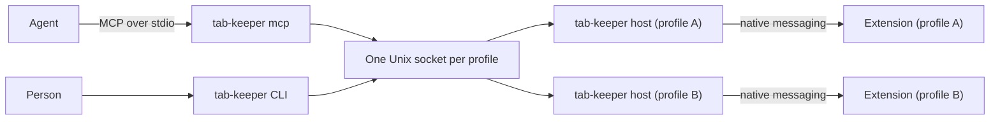

# tab-keeper: project overview

**tab-keeper lets people and agents list, close, group and arrange Chrome tabs across every profile.** It is a Manifest
V3 extension and a local Rust program, and it never gets access to page contents.

|            |                                                                      |
| ---------- | -------------------------------------------------------------------- |
| Repository | `tomasz-feliksik/tab-keeper` on GitHub, public                       |
| Crate      | `tab-keeper`                                                         |
| Binary     | `tab-keeper` (`tabs` collides with the ncurses command of that name) |
| Status     | Built, tested on Chromium and on branded Chrome in a NixOS VM        |

What each command does is in [`functionality.md`](./functionality.md). What to watch out for is in
[`things-to-keep-in-mind.md`](./things-to-keep-in-mind.md).

## Why it exists

People who use many profiles collect hundreds of tabs. One real browser had 337 tabs across five profiles and used 36.7
GB. Tidying that by hand does not happen, and it is a good job for an agent: read the list, suggest what to close and
how to group the rest, then wait for approval.

The existing tools each miss something that matters for this job. The comparison is in
[`things-to-keep-in-mind.md`](./things-to-keep-in-mind.md#alternatives-that-were-checked). In short:

- Browser automation tools (DevTools MCP, Playwright) give an agent far more power than tidying needs, and do not cover
  tab groups or every profile.
- Extension bridges either trust anything on a local port, cover one profile at a time, or cannot move tabs.

## How it fits together

- **Extension.** Chrome isolates extensions per profile, so each profile runs its own copy. It answers requests using
  Chrome's `tabs`, `tabGroups` and `bookmarks` APIs, and it is the last place a rule is enforced.
- **`tab-keeper host`.** Chrome starts this itself through native messaging, one for each connected extension. It relays
  between the extension's private pipes and a Unix socket that only this user can open.
- **`tab-keeper` CLI.** Finds the sockets, asks every profile and merges the answers.
- **`tab-keeper mcp`.** The same operations as MCP tools, started once per agent session.

There is no daemon, no port and no network listener.

## Decisions

| Decision                                                     | Why                                                                                                                                   |
| ------------------------------------------------------------ | ------------------------------------------------------------------------------------------------------------------------------------- |
| Own project, not a fork of an existing bridge                | The blockers are in the design: the transport, the single-extension hub, the missing move operation                                   |
| Native messaging, not a local port                           | Chrome starts the host and connects it by private pipes, so there is no port for another local user or service to reach               |
| Rust for the CLI, relay and MCP server; JS for the extension | One MCP process runs per agent session: 27 MB of Python across 43 sessions is about 1.2 GB. A small native binary is the requirement  |
| No incognito tabs, ever                                      | Incognito promises to leave nothing behind, and tab-keeper saves URLs before closing                                                  |
| No access to page contents                                   | No `scripting`, `debugger`, `cookies` or host permissions. Tidying needs titles and URLs, and this limits what a tricked agent can do |
| The agent proposes, the person approves                      | Read tools and write tools are separate, with correct MCP annotations, so the harness's permission prompt becomes the approval        |
| Save before closing                                          | An agent will sometimes be wrong. Closing is only acceptable if it can be undone                                                      |
| `rmcp` for the MCP server, not a hand-written layer          | Good libraries over our own code: it tracks the protocol, for about 0.3 MB and 0.7 MB of RSS more per session                         |
| No `nix-lib`                                                 | It is private, and this flake has to build for others because the repository is public                                                |
| No import-from-derivation                                    | A consumer may evaluate this flake with it disabled and with warnings as errors                                                       |
| Browser memory settings stay out of this project             | Memory Saver is a Chrome policy that belongs in the machine's own configuration. tab-keeper only reads its exemption list             |

Decisions that are still open are decision beads: `bd list --type decision`.

## Roadmap

| Milestone | Delivers                                                                  |
| --------- | ------------------------------------------------------------------------- |
| M1        | Rust port of `list` and `discard`, extension packaged, Home Manager host  |
| M2        | Close and restore, move, group: the operations that make tidying possible |
| M3        | MCP server                                                                |
| M4        | Bookmarks                                                                 |
| M5        | Named groups you can close and open again                                 |

The beads epics hold the detail: `bd list --type epic`.

## Out of scope

- Reading or changing page contents, clicking, filling forms.
- Sending tab data anywhere. Nothing leaves the machine except what an agent's own model provider receives through MCP,
  which is the person's choice when they connect that agent.
- Choosing which tabs to close. That judgement belongs to the agent and the person. tab-keeper provides the data and the
  safe operations.
- Browsers other than Chrome-family ones.

## Credit

The tool set, backup before closing, restore with groups, per-capability switches and enforcement inside the extension
all come from reading [chrome-toolbox-mcp](https://github.com/bjw2019/chrome-toolbox-mcp). It is a design reference
only, not a dependency, and no code was copied.
